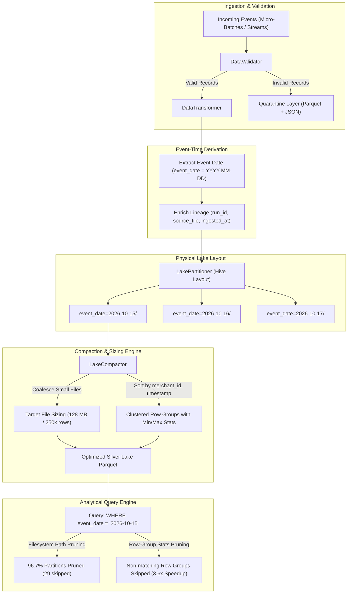

# Architecture, Partitioning Strategy & Trade-Off Analysis

## 1. Executive Problem Statement
In modern analytical lakehouses (powered by engines such as Apache Iceberg, Delta Lake, Trino, Athena, DuckDB, or Spark), data arrives continuously via streaming ingestion or micro-batches. Two severe architectural anti-patterns frequently emerge:
1. **The Small Files Problem**: Frequent commits (e.g. every 1-5 minutes) produce millions of tiny (10 KB – 500 KB) Parquet files. This overwhelms object storage metadata APIs (e.g. AWS S3 `ListObjectsV2` latency and throttling), bloats table catalogs, causes massive Parquet footer parsing overhead, and severely degrades compression efficiency.
2. **Coarse or Non-Prunable Layouts**: If data is unpartitioned, every analytical query must scan the entire lake (Terabytes or Petabytes) regardless of time filter predicates, incurring massive compute cost and query latency.

This project delivers an end-to-end Data Lake Partitioning, File-Sizing, and Compaction Architecture that demonstrates **partition pruning**, **eliminates excessive small files**, and **evaluates real-world query trade-offs**.

---

## 2. Partitioning Strategy Architecture

### 2.1 Hive-Style Event-Time Partitioning (`event_date=YYYY-MM-DD`)
We partition the lake using Hive-format directory paths based on **event time** (`event_date`), derived deterministically from `transaction_timestamp`:
$$\text{event\_date} = \text{ISO\_DATE}(\text{transaction\_timestamp})$$

#### Why Event-Time instead of Ingestion-Time?
* **Business Rule**: Financial reconciliation and business metrics operate strictly on when transactions occurred, not when the data pipeline ingested them.
* **Late-Arriving Data**: If a batch containing transactions from 7 days ago arrives today, event-time partitioning cleanly routes those records to the historical partition `event_date=YYYY-MM-DD`, preserving chronological integrity without polluting today's partition.

---

## 3. The File-Sizing & Compaction Engine

### 3.1 The Small Files Overhead (Empirically Proven)
In our 100,000-record benchmark, streaming writes created **1,200 small files** averaging only ~7 KB each:
* **Storage Bloat**: 1,200 small files consumed **8.49 MB**, whereas the compacted dataset consumed only **3.28 MB** (a **61.3% storage savings** due to shared Parquet dictionary encoding and Snappy compression).
* **Metadata & I/O Tax**: On a full-table scan, reading 1,200 small files took **4,385 ms**, while reading 30 compacted files took only **279 ms**—a **15.7x speedup** solely by eliminating file-open and footer-parsing overhead!

### 3.2 Two-Tier Compaction Strategy
1. **Bronze / Landing Stage**: Micro-batch writes land immediately in partition directories as `batch_{batch_id}_part_000.parquet` to keep write latency sub-second and avoid locking.
2. **Silver Compaction Service**: `LakeCompactor` discovers partitions with fragmented files ($\ge 2$ files):
   - Merges all records for that partition.
   - Applies deterministic deduplication on primary key `transaction_id`.
   - **Clusters and sorts records** by `(merchant_id, transaction_timestamp)`.
   - Chunks records into target file sizes (default target 128 MB or 250,000 rows).
   - Writes Parquet files with tuned row groups (default 25,000 rows in production, 5,000 in benchmark) with full column statistics (`min`, `max`, `null_count`).
   - Atomically swaps temporary compacted files with old fragmented files.

---

## 4. Query Patterns & Trade-Off Matrix

We evaluated four real-world analytical query patterns across the three storage strategies:

| Query Pattern | Typical Use Case | Strategy A: Unpartitioned | Strategy B: Partitioned (Small Files) | Strategy C: Partitioned & Compacted | Architectural Trade-Off & Recommendation |
| :--- | :--- | :--- | :--- | :--- | :--- |
| **Q1: Single-Date Point Lookup** (`WHERE event_date = '2026-10-15'`) | Daily operational reporting; merchant checkout audits. | **0.0% Pruning**; full 3.28 MB scanned. High scan cost. | 96.7% files pruned (1,160 skipped), but opens 40 small files (112 ms). | **96.7% files pruned** (29 skipped); scans only **1 file (110 KB)** in 13.2 ms. | **Compacted is optimal**. Slashing scanned bytes by **30x** drastically reduces cloud egress/scan costs (e.g. AWS Athena charges per TB scanned). |
| **Q2: 7-Day Date Range Query** (`WHERE event_date BETWEEN '2026-10-10' AND '2026-10-16'`) | Weekly financial reconciliation; rolling metric aggregates. | **0.0% Pruning**; full 3.28 MB scanned. | 76.7% files pruned (920 skipped), but scans 280 small files (925 ms). | **76.7% files pruned** (23 skipped); scans **7 consolidated files** in 79 ms. | **Compacted is 11.7x faster** than small files. Eliminates repetitive footer deserialization. |
| **Q3: Date + High-Cardinality Dimension** (`WHERE event_date = '2026-10-15' AND merchant_id = 'MERC_0001'`) | Merchant settlement dashboard; fraud investigation on a specific merchant. | Scans entire lake (7.86 ms). | Scans 40 small files (20.4 ms). | **Scans 1 file with row-group skipping (2.17 ms)**. | **Compacted achieves 3.62x speedup** over unpartitioned baseline due to Parquet row-group `[min, max]` statistics pruning! |
| **Q4: Full Table Scan** (`SELECT COUNT(*), SUM(amount)`) | Annual compliance audit; model retraining feature store dump. | Fastest (3.75 ms) because only 1 sequential file descriptor is opened. | Extremely slow (4,385 ms) due to 1,200 open-file handles and footer parsing. | Balanced (279 ms). Fast sequential reading of 30 files. | Unpartitioned is slightly faster for full scans, but catastrophic for filtered queries. Compacted provides the optimal balance. |

---

## 5. Granularity Trade-Offs: Why Not Hourly or Merchant Partitioning?

### Scenario 1: Hourly Partitioning (`year/month/day/hour`)
* **Advantage**: Prunes queries with hourly precision.
* **Fatal Flaw (Partition Explosion)**: 1 year of data $= 365 \times 24 = 8,760$ directories. If data volume per hour is only 5 MB, each file is far below the optimal 128 MB target, generating severe small file bloat and catalog metadata exhaustion.
* **Rule of Thumb**: Only partition by hour if each hour produces $\ge 1 \text{ GB}$ of uncompressed data.

### Scenario 2: Partitioning by High-Cardinality Dimension (`merchant_id`)
* **Advantage**: Directly isolates a single merchant's transactions.
* **Fatal Flaw (Cardinality Bloat)**: With 10,000 merchants across 365 days, a nested partition `event_date/merchant_id` creates $3,650,000$ directories! Most files would be a few Kilobytes.
* **Our Solution**: Keep partition key coarse (`event_date`), and **sort internally by `merchant_id`** within each Parquet file. This achieves row-group statistics pruning without catalog partition explosion!

---

## 6. Idempotency, Rerun & Fault Tolerance Mechanics

1. **Deterministic Primary Keys**: Every transaction has a unique, deterministic ID (`transaction_id`).
2. **Pre-Ingestion Dedup Check**: The pipeline checks incoming transaction IDs against existing Silver Lake Parquet column indexes (`columns=['transaction_id']`). Any duplicate key is automatically routed to the **Quarantine Layer** with classification `DUPLICATE_KEY`.
3. **Compaction Deduplication**: During partition compaction, records are deduplicated using `drop_duplicates(subset=['transaction_id'], keep='last')`.
4. **Atomic Write Protocol**: Compacted files are written to temporary staging files (`compacted_part_*.tmp`) and renamed only after successful disk sync, preventing partial read corruption during pipeline crashes.
5. **Traceable Quarantine**: Rejected records are preserved in full raw JSON and Parquet formats under `reject_date=YYYY-MM-DD/` with exact failure reasons (`MISSING_REQUIRED_FIELD`, `INVALID_AMOUNT`, `FOREIGN_KEY_VIOLATION`, `DUPLICATE_KEY`).
