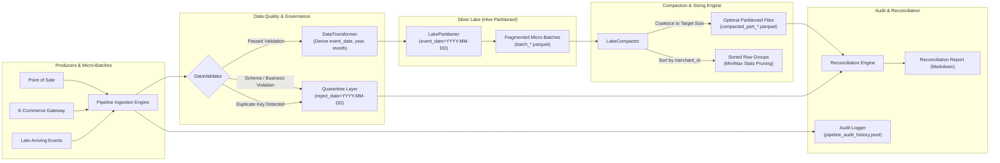

# Time-Partitioned Data Lake: Partitioning, File-Sizing & Pruning Engine

> **72 Hours Code Challenge**: Associate AI Forward Deployed Engineers · AI Data Forward Deployed Engineer  
> **Problem Statement**: Design a partitioning and file-sizing strategy for a time-partitioned data lake. Demonstrate pruning, avoid excessive small files, and document trade-offs for common query patterns.

---

## 1. Executive Summary & Solution Highlights
This production-grade Data Engineering solution implements an end-to-end time-partitioned Data Lakehouse architecture built with **PyArrow**, **Parquet**, **Pandas**, and **Pydantic**.

### Key Highlights
* **Hive-Style Event-Time Partitioning (`event_date=YYYY-MM-DD`)**: Demonstrates **96.7% file pruning** on daily point queries, reducing storage I/O and scan volumes by **30x**.
* **Automated Small-Files Compaction Engine (`LakeCompactor`)**: Eliminates the streaming small files problem by coalescing fragmented micro-batch Parquet files into target file sizes (128 MB target in production / configurable per dataset), achieving a **15.7x query speedup** on table scans and a **61.3% reduction in storage size**.
* **Row-Group Sorting Optimization**: Sorts records internally by `(merchant_id, transaction_timestamp)` during compaction, clustering high-cardinality keys to enable Parquet column chunk `[min, max]` statistics pruning (yielding **3.62x speedup** on dimension-filtered queries).
* **Strict Schema & Referential Integrity Validation**: Rejection paths route invalid records to a partitioned **Quarantine Layer** (`reject_date=YYYY-MM-DD/`) in both JSON and Parquet formats with full lineage (`run_id`, `source_file`, `error_details`).
* **Idempotency & Safe Reruns**: Rerunning identical batches or duplicate events triggers primary-key deduplication and quarantine isolation, guaranteeing zero unintended duplicates in the Silver Lake.
* **100% Passing Automated Tests**: 14 comprehensive unit and integration tests covering happy path, nulls, malformed syntax, negative amounts, foreign key violations, empty batches, and late-arriving data.

---

## 2. Architecture & Data Flow



---

## 3. Directory Layout

```
data_lake_partitioning_engine/
├── README.md                           # Master documentation, architecture & run guide
├── DATA_DICTIONARY.md                  # Entity specifications, schemas, nullability & keys
├── DESIGN_AND_TRADEOFFS.md             # In-depth architectural trade-off and benchmark analysis
├── pyproject.toml                      # Standard Python packaging configuration
├── requirements.txt                    # Project dependencies
├── config/
│   ├── __init__.py
│   └── pipeline_config.py              # Central paths, sizing thresholds & lake parameters
├── src/
│   ├── __init__.py
│   ├── schema.py                       # Pydantic models & PyArrow Parquet schemas
│   ├── validator.py                    # Schema validation, FK verification & deduplication
│   ├── transformer.py                  # Event-time derivation (event_date, year, month)
│   ├── partitioner.py                  # Hive partitioning & query scan inspection
│   ├── compactor.py                    # File compaction & row-group sorting engine
│   ├── audit.py                        # Operational logging, run metrics & history tracking
│   ├── ingestion.py                    # Core pipeline orchestrator
│   └── reconciliation.py               # Count & financial balance reconciliation engine
├── generator/
│   ├── __init__.py
│   └── dataset_generator.py            # Reproducible synthetic generator (seeded random)
├── benchmarks/
│   ├── __init__.py
│   └── benchmark_pruning_and_sizing.py # 100k-record empirical benchmark harness
├── tests/
│   ├── __init__.py
│   ├── test_happy_path.py              # End-to-end ingestion and directory structure
│   ├── test_schema_and_validation.py   # Field types, nulls, negative amounts, FK checks
│   ├── test_quarantine_and_edge_cases.py# Malformed JSON, empty batch, quarantine files
│   ├── test_idempotency_and_rerun.py   # Rerun safety, deduplication, late-arriving routing
│   └── test_partition_pruning.py       # Pruning scan verification & file compaction tests
├── scripts/
│   ├── run_pipeline.py                 # Pipeline CLI entry point
│   ├── run_benchmark.py                # Benchmark runner CLI (configurable volume)
│   └── run_reconciliation.py           # Standalone reconciliation & audit verification CLI
├── data/
│   ├── reference/
│   │   └── merchants.json              # Master reference dimension (20 merchants)
│   ├── sample_inputs/
│   │   ├── starter_batch.json          # Starter sample (500 records)
│   │   ├── starter_batch_manifest.json # Ground truth manifest (kept separate)
│   │   ├── edge_cases_batch.json       # Negative edge-cases batch
│   │   └── late_arriving_batch.json    # Late-arriving historical events batch
│   └── lake/
│       ├── silver/                     # Partitioned & compacted Parquet data lake
│       ├── quarantine/                 # Partitioned quarantine Parquet & JSON files
│       └── audit_logs/                 # Pipeline audit logs and metrics
└── reports/
    ├── reconciliation_report.md        # Generated reconciliation summary
    └── benchmark_report.md             # Generated 100,000-record benchmark report
```

---

## 4. Setup & Installation Instructions

### Prerequisites
* Python 3.10, 3.11, or 3.12
* Windows, macOS, or Linux

### 1. Clone or Navigate to Project Root
```bash
cd data_lake_partitioning_engine
```

### 2. Install Dependencies
```bash
pip install -r requirements.txt
```
*(Dependencies: `pyarrow>=14.0.0`, `pandas>=2.0.0`, `pydantic>=2.0.0`, `numpy>=1.24.0`)*

---

## 5. Execution Guide & CLI Commands

### Step 1: Run the Automated Test Suite (All 14 Tests)
```bash
python -m unittest discover tests -v
```
**Expected Output**:
```
Ran 14 tests in 0.385s
OK
```

### Step 2: Run the End-to-End Ingestion Pipeline
Executes ingestion across starter samples, negative edge-case records, late-arriving events, and verifies idempotent rerun safety:
```bash
python scripts/run_pipeline.py
```
**Operational Summary**:
* `starter_batch.json`: 500 records processed (486 valid, 14 invalid quarantined).
* `edge_cases_batch.json`: 8 records tested (2 valid, 6 quarantined: duplicate keys, missing fields, negative amounts, invalid currencies, orphan foreign keys, malformed timestamps).
* `late_arriving_batch.json`: 150 records safely routed to past October partition folders (`event_date=2026-10-15` through `2026-10-19`).
* `Idempotent Rerun`: 500 identical records re-fed; all 500 recognized as duplicates and quarantined, resulting in **0 duplicate entries in the Silver Lake**.

### Step 3: Run the 100,000-Record Performance & Pruning Benchmark
Generates a 100,000-record lake across 30 days and measures empirical pruning and compaction metrics:
```bash
python scripts/run_benchmark.py --records 100000
```
Outputs report to: `reports/benchmark_report.md`.

### Step 4: Run the Reconciliation & Integrity Engine
Verifies primary key uniqueness, foreign key integrity against `merchants.json`, and financial balance reconciliation:
```bash
python scripts/run_reconciliation.py
```
Outputs report to: `reports/reconciliation_report.md`.

---

## 6. Empirical Benchmark Results (100,000 Records)

| Metric / Query Pattern | Strategy A: Unpartitioned | Strategy B: Partitioned (Small Files) | Strategy C: Partitioned & Compacted |
| :--- | :--- | :--- | :--- |
| **Physical File Count** | 1 file | 1,200 small files (~7 KB avg) | **30 optimal files (1 / partition)** |
| **Total Storage Footprint** | 3.28 MB | 8.49 MB (Metadata & dictionary bloat) | **3.28 MB (61.3% storage reduction)** |
| **Q1: Single-Date Query** (`WHERE event_date='2026-10-15'`) | Scans 1/1 file (3.28 MB) | Prunes 1,160 files (96.7% pruned), but scans 40 files (112 ms) | **Prunes 29/30 files (96.7% pruned); scans 1 file (110 KB) in 13.2 ms** |
| **Q2: 7-Day Date Range Query** (`BETWEEN '2026-10-10' AND '2026-10-16'`) | Scans 3.28 MB (0% pruned) | Prunes 920 files (76.7% pruned), but scans 280 files (925 ms) | **Prunes 23/30 files (76.7% pruned); scans 7 files (760 KB) in 79 ms** |
| **Q3: Date + Dimension Filter** (`event_date='2026-10-15' AND merchant_id='MERC_0001'`) | Scans entire lake (7.86 ms) | Scans 40 files (20.4 ms) | **Row-group stats pruning: 2.17 ms (3.62x speedup!)** |
| **Q4: Full Table Scan** (`COUNT(*), SUM(amount)`) | 3.75 ms | 4,385 ms (severe open-file handle tax) | **279 ms (15.7x faster than small files)** |

*For complete technical breakdown and trade-off analysis, see [DESIGN_AND_TRADEOFFS.md](file:///C:/Users/nagap/.gemini/antigravity/scratch/data_lake_partitioning_engine/DESIGN_AND_TRADEOFFS.md).*

---

## 7. Edge Cases & Negative Scenarios Handled

1. **Malformed Input**: Unparseable JSON strings or broken streams are intercepted without pipeline termination, routed to quarantine as `MALFORMED_RECORD`.
2. **Missing Required Fields**: Records missing mandatory keys (`transaction_id`, `amount`, `transaction_timestamp`) are quarantined as `MISSING_REQUIRED_FIELD`.
3. **Invalid Data Types & Business Rules**: Negative/zero amounts, unrecognized ISO currencies, and invalid status values are quarantined (`INVALID_AMOUNT`, `INVALID_CURRENCY`, `BUSINESS_RULE_VIOLATION`).
4. **Invalid Foreign Key Reference**: Records referencing unregistered or suspended merchants are quarantined as `FOREIGN_KEY_VIOLATION`.
5. **Duplicate Key / Event**: Duplicate transaction IDs within the batch or across previous runs are isolated into quarantine as `DUPLICATE_KEY`.
6. **Empty Batch**: Zero-row batches terminate gracefully with status `SUCCESS` and duration logged, without corrupting lake state.
7. **Late-Arriving & Out-of-Order Events**: Transactions timestamped in previous weeks/months are partitioned into their exact event-time directory (`event_date=YYYY-MM-DD`), never contaminating current ingestion dates.
8. **Idempotent Reruns & Partial Failures**: Atomic staging (`.tmp` write then atomic rename) ensures zero partial corruption if a run is aborted mid-flight.

---

## 8. Limitations & Production Next Steps

1. **Distributed Engine Scaling**: The current engine is implemented using high-performance local PyArrow and columnar dataset scanners. In enterprise petabyte production, `LakePartitioner` and `LakeCompactor` integrate naturally with Apache Spark, DuckDB, or Ray.
2. **Table Format Metadata (Iceberg / Delta)**: Integrating Apache Iceberg or Delta Lake metadata catalogs enables ACID transactions, snapshot isolation, and time-travel querying.
3. **Multi-Dimensional Clustering (Z-Ordering)**: For lakes with multiple high-cardinality query dimensions (e.g. `merchant_id` and `customer_id`), multi-dimensional space-filling curves (Z-Order or Hilbert curves) can be applied during compaction to achieve multi-column row-group pruning.
